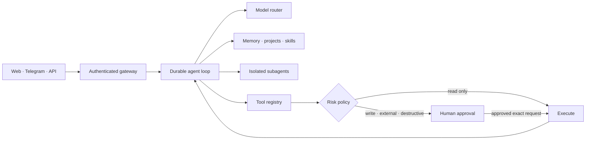

<p align="center">
  
</p>

<h1 align="center">Barlas AI Agent</h1>

<p align="center">
  <strong>A private, persistent, autonomous AI agent built to plan deeply, act safely, and grow with its owner.</strong>
</p>

<p align="center">
  
  
  
  
</p>

<p align="center">
  <a href="#-quick-install"><strong>Install</strong></a> ·
  <a href="docs/ARCHITECTURE.md"><strong>Architecture</strong></a> ·
  <a href="docs/API.md"><strong>API</strong></a> ·
  <a href="docs/SECURITY.md"><strong>Security</strong></a> ·
  <a href="docs/ROADMAP.md"><strong>Roadmap</strong></a>
</p>

<p align="center">
  <a href="docs/PRODUCT_OVERVIEW_MULTILINGUAL.md#tr">Türkçe</a> ·
  <a href="docs/PRODUCT_OVERVIEW_MULTILINGUAL.md#az">Azərbaycanca</a> ·
  <a href="docs/PRODUCT_OVERVIEW_MULTILINGUAL.md#uz">O‘zbekcha</a> ·
  <a href="docs/PRODUCT_OVERVIEW_MULTILINGUAL.md#kk">Қазақша</a> ·
  <a href="docs/PRODUCT_OVERVIEW_MULTILINGUAL.md#ky">Кыргызча</a> ·
  <a href="docs/PRODUCT_OVERVIEW_MULTILINGUAL.md#ug">ئۇيغۇرچە</a> ·
  <a href="docs/PRODUCT_OVERVIEW_MULTILINGUAL.md#mn">Монгол хэл</a> ·
  <a href="docs/PRODUCT_OVERVIEW_MULTILINGUAL.md#ru">Русский</a> ·
  <a href="docs/PRODUCT_OVERVIEW_MULTILINGUAL.md#en">English</a> ·
  <a href="docs/PRODUCT_OVERVIEW_MULTILINGUAL.md"><strong>All 38</strong></a>
</p>

---

## Built to do real work

Barlas AI Agent is an independent, brand-owned platform built for reliable
autonomous work. It is not a chat wrapper: it can hold a goal, build a plan,
use tools, delegate work, pause for approval, recover after interruption, and
preserve project state.

| | Capability | What it means |
|---|---|---|
| 🧠 | **Persistent intelligence** | Conversations, explicit memory, semantic recall, user language, and project context survive across sessions. |
| ⚙️ | **Autonomous execution** | Durable multi-step runs, background workers, retries, recovery, cancellation, schedules, and live progress. |
| 🧩 | **Skills that evolve safely** | Versioned skills, acceptance tests, activation gates, strict tool permissions, and rollback. |
| 🕸️ | **Parallel subagents** | The main agent can delegate bounded analytical work to isolated, non-recursive subagents. |
| 🖥️ | **Real tools** | Files, documents, web research, JavaScript browser, offline Python/Node/Git/npm sandbox, MCP, and connected services. |
| 👁️ | **Multimodal understanding** | Images, scanned PDFs, audio transcription, speech generation, and Unicode document workflows. |
| 🎙️ | **Telegram voice mode** | `/voice` and `/call` return an agent answer as a bounded Telegram voice message through the official Bot API. |
| 🗣️ | **Private push-to-talk** | The web chat records only after an explicit click, discards microphone audio after transcription, keeps conversation context, and plays the spoken answer. |
| 📁 | **Project operating system** | Goals, ordered plans, checkpoints, linked runs, immutable artifact versions, and recoverable results. |
| 🛡️ | **Human control** | External, write, and destructive operations stop before execution and require approval of the exact stored request. |

## How it works



Every autonomous run is persisted before the first model call. A restart,
expired worker lease, Telegram approval, or temporary provider failure does not
erase the task or silently convert an unfinished action into success.

## 🚀 Quick install

### Windows 10/11

Open PowerShell and run one command:

```powershell
irm https://raw.githubusercontent.com/WatcherAI-1997/barlas-ai-agent/main/install-windows.ps1 | iex
```

No GitHub login, Git, Node.js, Docker, WSL, domain, or Bash shell is required.
The bootstrap installs a private portable Node.js runtime, an embedded
PostgreSQL-compatible PGlite database, and a private Chromium runtime under
`%LOCALAPPDATA%\Barlas`. It creates a configuration protected by a Windows ACL,
adds the `barlas` command to the user PATH, enables current-user autostart, and
opens the cabinet. The service binds only to `http://127.0.0.1:17840`; Telegram
uses long polling.

Native laptop mode intentionally does not provide the container-isolated code
sandbox. Use the Linux/Docker server deployment when untrusted code execution
needs the strongest isolation.

After installation, open a new PowerShell window:

```powershell
barlas
barlas ask "Проверь проект и составь план"
```

Run `barlas onboard` for the full guided setup. It offers `complete`, `quick`, `private`,
`developer`, `server`, and `import` profiles, then configures the agent identity,
model authentication and voice, memory, browser/tools, channels, integrations,
automations, and security. Use commands such as `barlas configure identity`, `barlas configure models`, or
`barlas configure channels` to revisit one section. The gateway restarts and a
live diagnostic runs automatically after onboarding.

`barlas` opens a continuous terminal conversation: replies share one stored
context until `/new` is used. `/sessions` lists earlier conversations and
`/use ID` resumes one. The same prompt accepts `/runs`, `/jobs`, `/cron`,
`/memory QUERY`, `/skills`, `/plugins`, `/models`, `/channels`, `/tools`,
`/nodes`, `/approvals`, `/approve ID`, `/reject ID`, and `/cancel RUN_ID`, so
routine operation does not require leaving the chat.

Create independent agent profiles with their own identity, model-routing class,
and optional project workspace:

```powershell
barlas projects
barlas agents create research "Researcher" --style analytical --task deep --project PROJECT_ID --instructions "Use primary evidence"
barlas agents
barlas agent "Investigate this topic" --profile AGENT_ID
```

Inside interactive chat, `/agents` lists profiles and `/agent ID` starts a new
conversation with one. Each conversation is permanently bound to its selected
profile; attempts to reuse it with a different or foreign profile are rejected.

### Linux

For a local installation without a domain, DNS, Caddy, or public web exposure,
run:

```bash
git clone https://github.com/WatcherAI-1997/barlas-ai-agent.git
cd barlas-ai-agent
./install.sh --local
```

On either operating system, the cabinet opens only on
`http://127.0.0.1:17840`. If a Telegram bot token is
provided, local mode uses the official Bot API long polling, so Telegram also
works without a webhook, domain, or HTTPS certificate.

Discord also works without a domain through the official Discord Gateway.
Run `barlas configure channels`, provide a dedicated bot token, and enable the
Message Content intent in the Discord developer portal. Barlas answers all
direct messages and only explicitly mentioned guild messages, ignores other
bots, suppresses outgoing mention expansion, and preserves the same durable
run and approval boundaries (`!approve ID` / `!reject ID`).

Slack works without a domain through official Socket Mode. Configure an
`xoxb-` bot token and an `xapp-` app-level token with `connections:write`;
Barlas accepts direct messages and `app_mention` events without exposing a
webhook or inbound port.

After installation, work from the terminal without copying a token:

```bash
./barlas                 # interactive CLI/TUI
./barlas ask "Проверь проект и составь план"
./barlas approvals
./barlas approve APPROVAL_ID
./barlas extensions          # capabilities and configuration state
./barlas nodes               # paired desktop/mobile nodes
./barlas node-pair           # one-time pairing code
```

On native Windows, install the least-privilege tray node with:

```powershell
barlas node install
```

It runs only for the current Windows user, stores its independent revocable
token with Windows DPAPI, advertises only `notifications`, and cannot execute
shell commands. Remove it with `barlas node uninstall`; revoke its token from
`barlas nodes` or the web cabinet. A standalone checksum-pinned bootstrap is
also available as `install-node-windows.ps1` for a different Windows device.

```powershell
irm https://raw.githubusercontent.com/WatcherAI-1997/barlas-ai-agent/main/install-node-windows.ps1 | iex
```

The installation includes 30 active built-in skills. The core pack covers
grounded and academic research, code inspection and delivery, debugging, TDD,
GitHub, browser operation, architecture diagrams, DOCX/PDF, Markdown notes,
video transcripts, Google Workspace, meeting and document actions, weekly
planning, inbox triage, price and competitor monitoring, natural-language
editing, and blocked-page recovery. The skills are compiled into the Barlas
image: the installer does not download or execute third-party scripts at
runtime. Skills that need an optional connector simply expose those actions
when the connector is configured.

Third-party skills use signed JSON packages instead of installer scripts. An
owner first runs `barlas skills verify package.json`, compares the displayed
Ed25519 SHA-256 fingerprint with an independent publisher source, and then
installs with `barlas skills install package.json --trust sha256:...`. The
signature covers the publisher identity, complete skill instructions, tool
allowlist, version, and acceptance cases. A candidate remains inactive until
its bounded, tool-free evaluation passes; every later activation or rollback
must target an already evaluated exact version. Publisher keys can be created
with `barlas skills keygen NAME`, and package templates signed with
`barlas skills sign TEMPLATE PRIVATE_KEY OUTPUT`.

Signed catalogs add discovery without weakening that boundary. `barlas skills
catalog list` accepts only an explicitly trusted, unexpired Ed25519 index;
package URLs must use HTTPS with redirects disabled, package bytes are pinned
by SHA-256, publisher signatures are checked independently, signed revocations
are enforced, and cached sequence numbers detect catalog rollback. Catalog
trust never silently becomes publisher trust.

The extension catalog declares each built-in channel, connector, provider,
runtime, skill source, and device bridge together with its capabilities, risk
classes, and required setting names. It never returns secret values.

The maintained [product capability map](docs/PRODUCT_CAPABILITIES.md) shows what
is implemented, what is only a foundation, and what still remains; the project
does not label planned work as finished functionality.

Text and autonomous tool execution can use an OpenAI account through secure
browser sign-in, native OpenAI Responses with an API key, native Anthropic
Messages, or a free local Ollama model
(`MODEL_PROVIDER=codex_cli|openai|anthropic|ollama`). The account session stays
in the official CLI credential store; Barlas neither copies nor displays its
OAuth tokens. Use `barlas models login`, `barlas models auth-status`, and
`barlas models logout` to manage it. The Windows wizard can install
Ollama with `winget`, start its local API, and pull the selected model. Ollama
chat and tool continuations stay on the configured local endpoint and have zero
provider cost. OpenAI-only media and embeddings remain optional through a
separate `MEDIA_API_KEY`, so credentials are never silently reused across
providers.

Device nodes use a separate one-time pairing code and receive an independently
revocable bearer token. The initial protocol supports heartbeat, capability
advertising, command acknowledgement, and approval-gated notifications only;
it deliberately does not expose a shell, camera, microphone, or screen.

For a public HTTPS deployment on a dedicated Linux server, run `./install.sh`
without `--local` and provide a domain.

The guided installer checks prerequisites, asks only for relevant values,
generates independent cryptographic secrets, protects them with mode `0600`,
validates the entire production stack, starts it, and runs diagnostics.

The owner dashboard uses a generated Barlas gateway token instead of a login
and password. Run `./scripts/dashboard-url.sh` on the server to produce a
bootstrap `#token=...` link; the fragment is stripped after the browser stores
it for the current tab.

```bash
# Prepare and validate without starting anything
./install.sh --prepare-only

# Diagnose an existing deployment
./scripts/doctor.sh --require-running
```

> [!IMPORTANT]
> Never paste production passwords or tokens into chat. Enter them directly on
> the target server. Barlas does not import credentials or data from another
> agent installation.

Read the full [installation guide](docs/INSTALLATION.md) for non-interactive
setup, port strategy, updates, troubleshooting, and the exact data layout.

Barlas AI Agent is free and open source under the [MIT License](LICENSE).

## Security by design

- **Tenant isolation:** user identity comes from authenticated execution
  context, never from model-supplied input.
- **Approval before effect:** write, external, and destructive tools persist
  their validated arguments and stop until the same user decides.
- **Container boundaries:** production API, PostgreSQL, browser, sandbox,
  backups, networks, and volumes are dedicated to Barlas.
- **No host shell:** code runs in an offline, constrained container without the
  Docker socket, host filesystem, public ports, or internal network.
- **Encrypted connections:** connector secrets use AES-256-GCM with a dedicated
  operator-controlled vault key.
- **Auditable behavior:** quotas, traces, approval decisions, tool execution,
  recovery, and project changes are recorded without copying sensitive bodies.
- **SSRF resistance:** browser, web, and MCP paths reject local/private networks,
  unsafe redirects, nonstandard ports, and oversized responses.

See the [security policy](docs/SECURITY.md),
[isolation model](docs/ISOLATION.md), and
[release gates](docs/RELEASE_READINESS.md).

## Current state

**Private alpha · 155 automated tests · 21 PostgreSQL migrations · npm audit: 0 known vulnerabilities**

The functional agent core, web cabinet, Telegram channel, project system,
recurring tasks, multimodal tools, sandbox, browser, MCP, encrypted connectors,
production Compose, backups, recovery procedures, and evaluation framework are
implemented. A public release remains intentionally blocked until dedicated
production credentials, a domain, live model evaluations, an independent
security review, recovery rehearsal, and a monitored closed-alpha period are
complete.

## Documentation

| Start here | Build and operate | Trust and release |
|---|---|---|
| [Installation](docs/INSTALLATION.md) | [Architecture](docs/ARCHITECTURE.md) | [Security](docs/SECURITY.md) |
| [Multilingual overview](docs/PRODUCT_OVERVIEW_MULTILINGUAL.md) | [API reference](docs/API.md) | [Isolation policy](docs/ISOLATION.md) |
| [Roadmap](docs/ROADMAP.md) | [Production deployment](docs/DEPLOYMENT.md) | [Release readiness](docs/RELEASE_READINESS.md) |
| [Agent evaluation](docs/AGENT_EVALUATION.md) | [Backup and recovery](docs/BACKUP_RECOVERY.md) | [Acceptable use](docs/ACCEPTABLE_USE.md) |

<details>
<summary><strong>Local development verification</strong></summary>

```bash
npm install
npm run check:isolation
npm run typecheck
npm test
npm run build
```

Copy `.env.example` to `.env` only inside an isolated development environment
and replace every placeholder before starting containers.

</details>

<details>
<summary><strong>Policies and legal templates</strong></summary>

- [Privacy policy template](docs/PRIVACY_POLICY_TEMPLATE.md)
- [Terms of use template](docs/TERMS_OF_USE_TEMPLATE.md)
- [Acceptable use](docs/ACCEPTABLE_USE.md)
- [Security policy](docs/SECURITY.md)

</details>

---

<p align="center">
  <strong>THINK AHEAD. ACT BEYOND.</strong><br>
  Built as an independent system. Designed to remain under human control.
</p>
