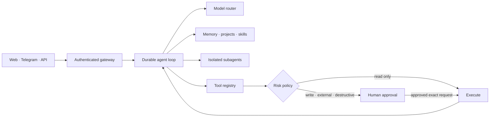

<p align="center">
  
</p>

<h1 align="center">Barlas AI Agent</h1>

<p align="center">
  <strong>A private, persistent, autonomous AI agent built to plan deeply, act safely, and grow with its owner.</strong>
</p>

<p align="center">
  
  
  
  
</p>

<p align="center">
  <a href="#-quick-install"><strong>Install</strong></a> ·
  <a href="docs/ARCHITECTURE.md"><strong>Architecture</strong></a> ·
  <a href="docs/API.md"><strong>API</strong></a> ·
  <a href="docs/SECURITY.md"><strong>Security</strong></a> ·
  <a href="docs/ROADMAP.md"><strong>Roadmap</strong></a>
</p>

<p align="center">
  <a href="docs/PRODUCT_OVERVIEW_MULTILINGUAL.md#tr">Türkçe</a> ·
  <a href="docs/PRODUCT_OVERVIEW_MULTILINGUAL.md#az">Azərbaycanca</a> ·
  <a href="docs/PRODUCT_OVERVIEW_MULTILINGUAL.md#uz">O‘zbekcha</a> ·
  <a href="docs/PRODUCT_OVERVIEW_MULTILINGUAL.md#kk">Қазақша</a> ·
  <a href="docs/PRODUCT_OVERVIEW_MULTILINGUAL.md#ky">Кыргызча</a> ·
  <a href="docs/PRODUCT_OVERVIEW_MULTILINGUAL.md#ug">ئۇيغۇرچە</a> ·
  <a href="docs/PRODUCT_OVERVIEW_MULTILINGUAL.md#mn">Монгол хэл</a> ·
  <a href="docs/PRODUCT_OVERVIEW_MULTILINGUAL.md#ru">Русский</a> ·
  <a href="docs/PRODUCT_OVERVIEW_MULTILINGUAL.md#en">English</a> ·
  <a href="docs/PRODUCT_OVERVIEW_MULTILINGUAL.md"><strong>All 38</strong></a>
</p>

---

## Built to do real work

Barlas AI Agent is an independent, brand-owned platform built for reliable
autonomous work. It is not a chat wrapper: it can hold a goal, build a plan,
use tools, delegate work, pause for approval, recover after interruption, and
preserve project state.

| | Capability | What it means |
|---|---|---|
| 🧠 | **Persistent intelligence** | Conversations, explicit memory, semantic recall, user language, and project context survive across sessions. |
| ⚙️ | **Autonomous execution** | Durable multi-step runs, background workers, retries, recovery, cancellation, schedules, and live progress. |
| 🧩 | **Skills that evolve safely** | Versioned skills, acceptance tests, activation gates, strict tool permissions, and rollback. |
| 🕸️ | **Parallel subagents** | The main agent can delegate bounded analytical work to isolated, non-recursive subagents. |
| 🖥️ | **Real tools** | Files, documents, web research, JavaScript browser, offline Python/Node/Git/npm sandbox, MCP, and connected services. |
| 👁️ | **Multimodal understanding** | Images, scanned PDFs, audio transcription, speech generation, and Unicode document workflows. |
| 📁 | **Project operating system** | Goals, ordered plans, checkpoints, linked runs, immutable artifact versions, and recoverable results. |
| 🛡️ | **Human control** | External, write, and destructive operations stop before execution and require approval of the exact stored request. |

## How it works



Every autonomous run is persisted before the first model call. A restart,
expired worker lease, Telegram approval, or temporary provider failure does not
erase the task or silently convert an unfinished action into success.

## 🚀 Quick install

The supported production path is a dedicated Linux server with Docker Compose.
Because this repository is private, authenticate with GitHub first:

```bash
gh auth login
gh repo clone WatcherAI-1997/barlas-ai-agent
cd barlas-ai-agent
./install.sh
```

The guided installer checks prerequisites, asks for deployment-specific values,
generates independent cryptographic secrets, protects them with mode `0600`,
validates the entire production stack, starts it, and runs diagnostics.

The owner dashboard uses a generated Barlas gateway token instead of a login
and password. Run `./scripts/dashboard-url.sh` on the server to produce a
bootstrap `#token=...` link; the fragment is stripped after the browser stores
it for the current tab.

```bash
# Prepare and validate without starting anything
./install.sh --prepare-only

# Diagnose an existing deployment
./scripts/doctor.sh --require-running
```

> [!IMPORTANT]
> Never paste production passwords or tokens into chat. Enter them directly on
> the target server. Barlas does not import credentials or data from another
> agent installation.

Read the full [installation guide](docs/INSTALLATION.md) for non-interactive
setup, port strategy, updates, troubleshooting, and the exact data layout.

## Security by design

- **Tenant isolation:** user identity comes from authenticated execution
  context, never from model-supplied input.
- **Approval before effect:** write, external, and destructive tools persist
  their validated arguments and stop until the same user decides.
- **Container boundaries:** production API, PostgreSQL, browser, sandbox,
  backups, networks, and volumes are dedicated to Barlas.
- **No host shell:** code runs in an offline, constrained container without the
  Docker socket, host filesystem, public ports, or internal network.
- **Encrypted connections:** connector secrets use AES-256-GCM with a dedicated
  operator-controlled vault key.
- **Auditable behavior:** quotas, traces, approval decisions, tool execution,
  recovery, and project changes are recorded without copying sensitive bodies.
- **SSRF resistance:** browser, web, and MCP paths reject local/private networks,
  unsafe redirects, nonstandard ports, and oversized responses.

See the [security policy](docs/SECURITY.md),
[isolation model](docs/ISOLATION.md), and
[release gates](docs/RELEASE_READINESS.md).

## Current state

**Private alpha · 125 automated tests · 20 PostgreSQL migrations · npm audit: 0 known vulnerabilities**

The functional agent core, web cabinet, Telegram channel, project system,
recurring tasks, multimodal tools, sandbox, browser, MCP, encrypted connectors,
production Compose, backups, recovery procedures, and evaluation framework are
implemented. A public release remains intentionally blocked until dedicated
production credentials, a domain, live model evaluations, an independent
security review, recovery rehearsal, and a monitored closed-alpha period are
complete.

## Documentation

| Start here | Build and operate | Trust and release |
|---|---|---|
| [Installation](docs/INSTALLATION.md) | [Architecture](docs/ARCHITECTURE.md) | [Security](docs/SECURITY.md) |
| [Multilingual overview](docs/PRODUCT_OVERVIEW_MULTILINGUAL.md) | [API reference](docs/API.md) | [Isolation policy](docs/ISOLATION.md) |
| [Roadmap](docs/ROADMAP.md) | [Production deployment](docs/DEPLOYMENT.md) | [Release readiness](docs/RELEASE_READINESS.md) |
| [Agent evaluation](docs/AGENT_EVALUATION.md) | [Backup and recovery](docs/BACKUP_RECOVERY.md) | [Acceptable use](docs/ACCEPTABLE_USE.md) |

<details>
<summary><strong>Local development verification</strong></summary>

```bash
npm install
npm run check:isolation
npm run typecheck
npm test
npm run build
```

Copy `.env.example` to `.env` only inside an isolated development environment
and replace every placeholder before starting containers.

</details>

<details>
<summary><strong>Policies and legal templates</strong></summary>

- [Privacy policy template](docs/PRIVACY_POLICY_TEMPLATE.md)
- [Terms of use template](docs/TERMS_OF_USE_TEMPLATE.md)
- [Acceptable use](docs/ACCEPTABLE_USE.md)
- [Security policy](docs/SECURITY.md)

</details>

---

<p align="center">
  <strong>THINK AHEAD. ACT BEYOND.</strong><br>
  Built as an independent system. Designed to remain under human control.
</p>
